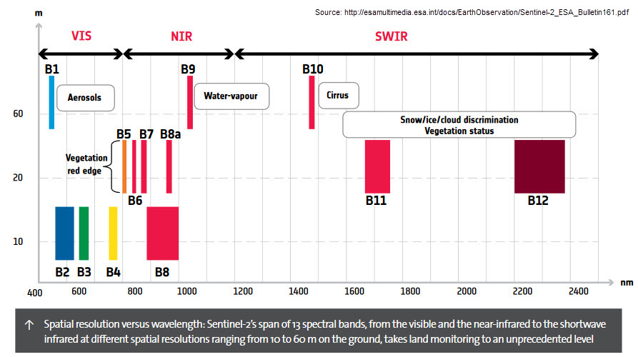
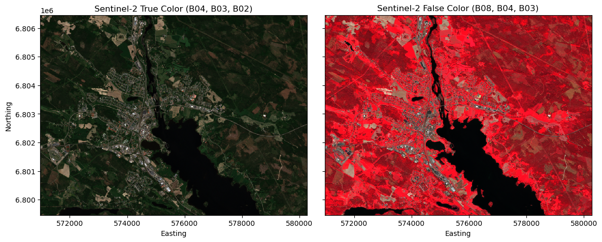

[Documentation home](../../README.md) · [Download Python script](session1_welcome_to_des.py)

Run from this directory with `python session1_welcome_to_des.py`. Read the guide first: the script runs all steps in order and may submit remote jobs. Figures and maps are saved under `outputs/session1_welcome_to_des/`.

> Saved outputs below come from the original teaching material; they are illustrations, not a fresh run against the current service.

# Session 1: Welcome to Digital Earth Sweden
**MOOC Series: From Satellite Data to Insights with Digital Earth Sweden**

---

## Session outline

- What is Digital Earth Sweden?
- A brief introduction to Earth observation and Sentinel-2
- Platform overview: user interface, API, and key resources
- Running your first Python script with the openEO API

By the end of this session you will have a working connection to the Digital Earth Sweden backend and be ready to load your first satellite image in Session 2.

---

## 1. What is Digital Earth Sweden?

**Digital Earth Sweden (DES)** is a workbench that makes Earth observation (EO) data accessible to researchers, public agencies, and developers across Sweden.

Key points:

- DES is developed by **RISE Research Institutes of Sweden** in collaboration with the Swedish National Space Agency (Rymdstyrelsen).
- The platform provides access to freely available satellite data, primarily from ESA (European Space Agency)'s **Copernicus** programme.
- Data is made available through open standards (openEO API, STAC, OGC WMS) so you can work with it from Python, QGIS, or a web browser.
- The platform is free to use for research and public-sector applications.

Official website: [https://digitalearth.se](https://digitalearth.se)

---

## 2. Introduction to Earth observation

**Earth observation** is the systematic collection of information about the Earth's surface and atmosphere using sensors on satellites, aircraft, and drones.

### Why satellites?

- They cover large areas repeatedly and consistently &mdash; the Sentinel-2 satellites have a swatch width of 290 km.
- Satellites revisit the same location every few days, enabling **monitoring** applications.
- They capture information beyond the visible spectrum, such as near-infrared (NIR), which is invisible to the human eye but highly informative for land cover analysis.

### Sentinel-2: the workhorse of this course

Sentinel-2 is a constellation of three satellites (Sentinel-2A, 2B, and 2C) operated by ESA as part of the Copernicus programme. Key facts:

| Property | Value |
|---|---|
| Spatial resolution | 10 m (visible + NIR), 20 m (red-edge, SWIR), 60 m (atmospheric) |
| Revisit time | \~5 days at the equator (\~3 days over Sweden) |
| Number of bands | 13 |
| Data access | Free and open |
| Archive start | 2015 (2018 on DES)|

The figure below shows the Sentinel-2 spectral bands with their respective spatial resolution:



### Step 4

```python
import openeo
import io
import numpy as np
import xarray as xr
import matplotlib.pyplot as plt

connection = openeo.connect('https://openeo.digitalearth.se')
connection.authenticate_basic(username='testuser', password='secretpassword')

aoi = {
    'west':  16.328473091125044,
    'east':  16.499276161193396,
    'south': 61.32281205270308,
    'north': 61.38375204609653,
    'crs':   'EPSG:4326',
}

image = connection.load_collection(
    collection_id='des_s2_msi_l2a',
    spatial_extent=aoi,
    temporal_extent=['2026-05-31', '2026-06-02'],
    bands=['B02', 'B03', 'B04', 'B08'],
).reduce_dimension(dimension='t', reducer='first')

image_tif = image.download(format='GTiff')

# Load into xarray
da = xr.open_dataarray(io.BytesIO(image_tif), engine='rasterio')
da = da.assign_coords(band=['B02', 'B03', 'B04', 'B08'])

# Rescale data
da = (da.astype(np.float32) / 10_000).clip(0, 1)

# Create different visualizations
true_color = da.sel(band=['B04', 'B03', 'B02'])
false_color = da.sel(band=['B08', 'B04', 'B03'])

fig, axs = plt.subplots(1, 2, figsize=(12, 10), sharey=True)
true_color.plot.imshow(rgb='band', vmin=0, vmax=0.4, ax=axs[0])
false_color.plot.imshow(rgb='band', vmin=0, vmax=0.4, ax=axs[1])
axs[0].set_aspect('equal')
axs[1].set_aspect('equal')
axs[0].set_title('Sentinel-2 True Color (B04, B03, B02)')
axs[1].set_title('Sentinel-2 False Color (B08, B04, B03)')
axs[0].set_xlabel('Easting')
axs[0].set_ylabel('Northing')
axs[1].set_xlabel('Easting')
axs[1].set_ylabel('')
plt.tight_layout()
display(
plt.show()
)
```



---

## 3. Platform overview

Digital Earth Sweden can be accessed in several ways, including:

1. **Web interface** — A browser-based map explorer for searching and previewing satellite scenes. Available at [https://digitalearth.se](https://digitalearth.se).

2. **openEO API** — A standard Application Programming Interface (API) for processing EO data in the cloud. This is what we use in this course. The Python client (`openeo`) translates your Python code into backend processes that run on DES infrastructure.


### What is openEO?

openEO is an open standard for accessing and processing large EO datasets in a cloud environment. The key idea is:

- You write Python code **locally**.
- The openEO client translates your operations into a **process graph**.
- The process graph is sent to the **DES backend** for execution — data never leaves the server until you explicitly download a result.
- This means you can process large volumes of EO data without storing anything on your laptop.

---

## 4. Installing the openEO Python client

Install the openEO Python package in your chosen environment with `python -m pip install openeo` before running the script.

### Step 8

```python
# Install the openEO Python client (run once)
# Install from the terminal: python -m pip install openeo
```

## 5. Connecting to the Digital Earth Sweden backend

The first step in every openEO workflow is to establish a **connection** to the backend. The backend URL for Digital Earth Sweden is `https://openeo.digitalearth.se`.

After connecting, we authenticate with a username and password. For this course you can use the shared test credentials below. In a production setting you would use your own account.

### Step 10

```python
import openeo

# Connect to the Digital Earth Sweden openEO backend
connection = openeo.connect('https://openeo.digitalearth.se')

# Authenticate with basic credentials
connection.authenticate_basic(username='testuser', password='secretpassword')

display(
print('Connected to:', connection.describe_account())
)
```

```text
Connected to: {'username': 'testuser', 'provider_id': 0, 'fullname': 'Test user', 'default_plan': 'Free', 'scopes': 'user storage', 'links': None}
```

## 6. Exploring what is available on the platform

Once connected, you can ask the backend which datasets (**collections**) are available. A collection is a large, time-series dataset containing satellite imagery or derived products.

In openEO, a collection is identified by a unique string ID such as `s2_msi_l2a` (Sentinel-2 Level-2A surface reflectance). We will use this collection throughout the course.

### Step 12

```python
# List all available collection IDs on Digital Earth Sweden
collection_ids = connection.list_collection_ids()
print('Collections:')
for cid in collection_ids:
    print(' -', cid)
```

```text
Collections:
 - des_s2_msi_l2a
 - NMD_2018_Basskikt_v1_1
 - NMD_2018_Produktivitet_v1_1
 - s2_msi_l1c
 - s2_msi_l2a
```

### Step 13

```python
# Inspect the metadata for the Sentinel-2 Level-2A collection
s2_info = connection.describe_collection('s2_msi_l2a')

print('Title      :', s2_info.get('title', 'N/A'))
print('Description:', s2_info.get('description', 'N/A')[:200], '...')
print('Spatial ext:', s2_info.get('extent', {}).get('spatial', 'N/A'))
display(
print('Temporal ext:', s2_info.get('extent', {}).get('temporal', 'N/A'))
)
```

```text
Title      : s2_msi_l2a
Description: Sentinel-2 MSI L2A Cloud-Optimized GeoTIFFs ...
Spatial ext: {'bbox': [[-180.00000000000003, 53.0712565262867, 179.52076997156803, 72.09958113071337]]}
Temporal ext: {'interval': [['2018-03-01T10:30:19.027000Z', '2026-07-12T10:26:01.025000Z']]}
```

## 7. Checking available processes

In addition to collections, the backend exposes a set of **processes** — built-in operations you can apply to your data (e.g. computing NDVI, reducing a time dimension, masking clouds). You can list them to discover what is supported.

### Step 15

```python
# List all available processes on the DES backend
processes = connection.list_processes()
process_names = [p['id'] for p in processes]
print(f'Total processes available: {len(process_names)}')
print('\nA selection of processes:')
selected = ['ndvi', 'mask', 'reduce_dimension', 'load_collection', 'save_result']
for name in selected:
    if name in process_names:
        print(f'  ✓ {name}')
    else:
        print(f'  ✗ {name} (not found)')
```

```text
Total processes available: 98

A selection of processes:
  ✓ ndvi
  ✓ mask
  ✓ reduce_dimension
  ✓ load_collection
  ✓ save_result
```

## Summary

In this session you:

- Learned what Digital Earth Sweden is and why it exists.
- Got an overview of Sentinel-2 and its key spectral bands.
- Understood the openEO model: local Python → process graph → backend execution.
- Established a working connection to the DES backend.
- Explored available collections and processes.

**Next session:** we will load your first Sentinel-2 scene, create a datacube, and visualise a satellite image for the first time.

---
*Digital Earth Sweden MOOC — Session 1 of 6*
