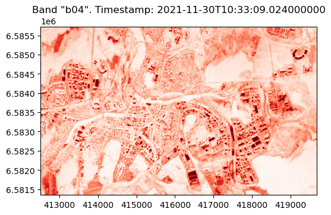
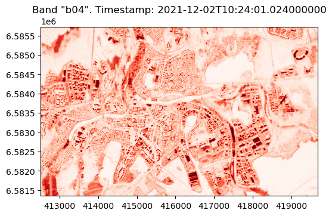
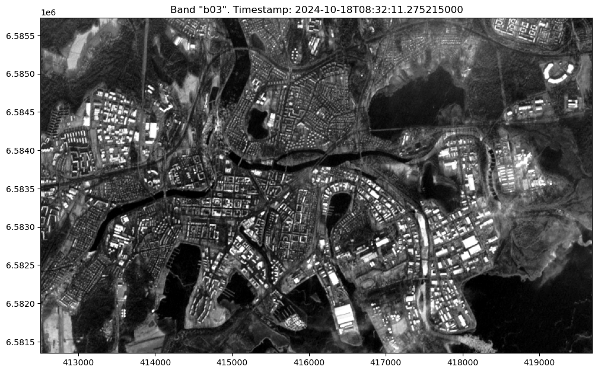
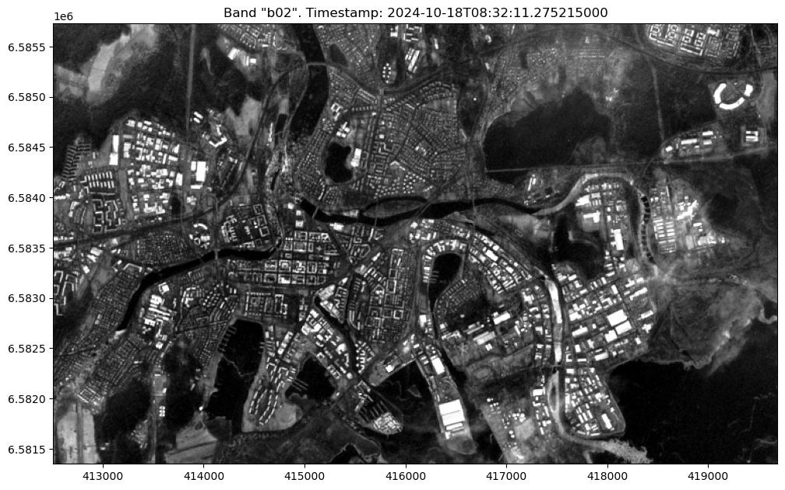
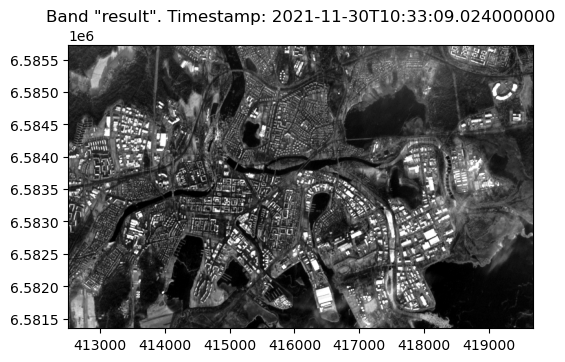
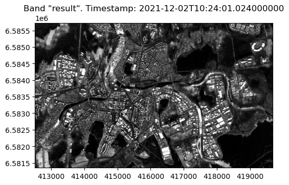

[Documentation home](../README.md) · [Download Python script](060_EO_020-Reductions.py)

Run from this directory with `python 060_EO_020-Reductions.py`. Read the guide first: the script runs all steps in order and may submit remote jobs. Figures and maps are saved under `outputs/060_EO_020-Reductions/`.

> Saved outputs below come from the original teaching material; they are illustrations, not a fresh run against the current service.

## Reducing dimensions

### Introduction

OpenEO has a library of processes. Processes are pre-defined functions that perform a certain analysis on the satellite data. Some examples are operations like addition and multiplication or aggregations like mean and median. In this guide we will show the process of reduction. It's an operation that will result in a reduced amount of dimensions in the Datacube.

### Objective

The objective of this tutorial is to teach you how a process works in action and explain the process of reduction.

### In this lesson, you will explore the following concepts:

A. **Processes**: Find out how to you can use processes to reshape satellite data.

B. **Reducing the dimensions of a Datacube**: OpenEO allows us to reduce the dimensions of a Datacube. We will explain the concept and do an example.

### Tools You'll Use:

- **OpenEO**: To interact with satellite data and perform operations on the Datacube.
- **Matplotlib**: For visualizing the results of your analysis.

### Learning Outcomes:

By the end of this tutorial, you will be able to:

- Know basic usage of OpenEO processes
- Reduce the amount of dimensions you want to work with

### Let's Begin:

We'll start by importing with creating a connection to the openeo back-end, we then proceed to download two images. We will now reduce those images in different ways. We start with reducing the time dimension, keeping only one image. Then we proceed with calculating the mean of the bands, reducing them into one single band for each image.

### Step 2

```python
import openeo
import numpy as np
from config import user,passwd,eo_service_url
from demo_regions import s2
from demo_helpers import show_result, show_zipped_results, plot_pixel_stats
```

### Step 3

```python
connection = openeo.connect(eo_service_url)
display(
connection.authenticate_basic(username=user, password=passwd)
)
```

```text
<Connection to 'https://openeo.digitalearth.se/' with BasicBearerAuth>
```

### Step 4

```python
s2_datacube=connection.load_collection(collection_id=s2.s2_msi_l2a,
                         spatial_extent=s2.bbox.karlstad_mini_land,
                         temporal_extent=s2.timespans.two_images,
                        bands=['b04', 'b03', 'b02'],
                        )
# - 'b04' (Red): The red band, with a central wavelength of 665 nm, commonly used in vegetation analysis.
# - 'b03' (Green): The green band, with a central wavelength of 560 nm, useful for monitoring plant health.
# - 'b02' (Blue): The blue band, with a central wavelength of 490 nm, often used in water body and atmospheric analysis.
```

### Step 5

```python
# Show information
print(s2_datacube.flat_graph())
s2_image_data = s2_datacube.download(format="gtiff")
original_images = show_result(s2_image_data, 'Reds')
display(
print("Shape of downloaded datacube (time,bands,x,y)",original_images.shape)
)
```

```text
{'loadcollection1': {'process_id': 'load_collection', 'arguments': {'bands': ['b04', 'b03', 'b02'], 'id': 's2_msi_l2a', 'spatial_extent': {'west': 13.460930954751282, 'east': 13.585449709728213, 'south': 59.36327761288911, 'north': 59.40107161575003}, 'temporal_extent': ['2021-11-30T00:00:00Z', '2021-12-03T00:00:00Z']}, 'result': True}}
Unzipping data....
Band 1: 0 NoData pixels out of 314484
Band 2: 0 NoData pixels out of 314484
Band 3: 0 NoData pixels out of 314484
```



```text
Band 1: 0 NoData pixels out of 314484
Band 2: 0 NoData pixels out of 314484
Band 3: 0 NoData pixels out of 314484
```



```text
Shape of downloaded datacube (time,bands,x,y) (2, 3, 438, 718)
```

# Reduction

Reductions in OpenEO are operations that reduce the dimensionality of the data. The `reduce_dimension` process collapses a whole dimension of the datacube. It does so by using some sort of reducer, which is a function that calculates a single result from an amount of values, as e.g. mean(), min() and max() which is calculated over a specified dimension (e.g., time, bands).


Figure: Overview of reducing the sample datacube. Dimensions that are reduced are crossed out in the result images. Their information value has been compressed by a reducer function. We are going to have data from two dates:

### Step 9

```python
display(
s2.timespans.two_images
)
```

```text
['2021-11-30T00:00:00Z', '2021-12-03T00:00:00Z']
```

### Time reduction
If we reduce the time and take the first we should only get the first image in the list.

### Step 11

```python
reduced_cube_over_time = s2_datacube.reduce_dimension(dimension="t", reducer="first")

# Show information
#print(reduced_cube_over_time.flat_graph())
s2_image_data_reduced = reduced_cube_over_time.download(format="gtiff")
```

### Step 12

```python
results_time_reduce=show_result(s2_image_data_reduced, colormap="Greys_r")
```






Let's check our results:

### Step 14

```python
display(
print("We expect a single raster/time but multible bands to look at, (time,bands,x,y):", results_time_reduce.shape)
)
```

```text
We expect a single raster/time but multible bands to look at, (time,bands,x,y): (1, 3, 438, 718)
```

#### Note of caution

It's important to understand the operation that a reducer will apply. For example you can search for "first" in the openeo processes below:

### Step 16

```python
display(
connection.list_processes()
)
```

[View saved example output](assets/060_EO_020-Reductions/16-0.html)

And get an explanation along the lines of "Gives the first element of an array." along with examples. When we apply the "first" reduction together with the time dimension we take the **first** element in the list of images (it might not be the earliest image chronologically).

The min/max reducers combined with the time dimension will reduce take the min/max value **for each** pixel for each band. For example, in our case we have two images, the compution takes min/max value of each pixel in band 'b04' between the two. It proceeds with the rest of the bands and returns an array with the pixelwise results for each band. Hence the time dimension has indeed been removed (reduced), but we have also combined each of the bands and produced 3 new bands as a result. The calculation will **not** return the bands of the earliest/latest image. 

### Band reduction
Let's try to reduce the dimension over the bands instead. In this example we choose the mean. This means that we will take the mean of the two bands that we have available for each day.

### Step 19

```python
reduced_cube_over_bands = s2_datacube.reduce_dimension(dimension="bands", reducer="mean")

# Show information
print(reduced_cube_over_bands.flat_graph())
# reduced_cube_over_bands.metadata
s2_image_data_reduced = reduced_cube_over_bands.download(format="gtiff")
results_bands_reduce = show_result(s2_image_data_reduced, "Greys_r")
```

```text
{'loadcollection1': {'process_id': 'load_collection', 'arguments': {'bands': ['b04', 'b03', 'b02'], 'id': 's2_msi_l2a', 'spatial_extent': {'west': 13.460930954751282, 'east': 13.585449709728213, 'south': 59.36327761288911, 'north': 59.40107161575003}, 'temporal_extent': ['2021-11-30T00:00:00Z', '2021-12-03T00:00:00Z']}}, 'reducedimension1': {'process_id': 'reduce_dimension', 'arguments': {'data': {'from_node': 'loadcollection1'}, 'dimension': 'bands', 'reducer': {'process_graph': {'mean1': {'process_id': 'mean', 'arguments': {'data': {'from_parameter': 'data'}}, 'result': True}}}}, 'result': True}}
Unzipping data....
Band 1: 0 NoData pixels out of 314484
```



```text
Band 1: 0 NoData pixels out of 314484
```



The figure show each image with the mean of Red, Blue, Green bands ('b04', 'b03', 'b02' respectively) in greyscale.

### Step 21

```python
display(
print(f"We expect multiple rasters/ time steps but only one band in (band,time,x,y):{results_bands_reduce.shape}") 
)
```

```text
We expect multiple rasters/ time steps but only one band in (band,time,x,y):(2, 1, 438, 718)
```

We can also check if the calculation is correct. We first calculate the mean of the bands of the first pixel from the first image:

### Step 23

```python
time = 0 
band = 0
pixel_x = 0
pixel_y = 0
print("Shape of results_time_reduce (time,bands,x.y):",results_time_reduce.shape)
display(
np.mean([results_time_reduce[time][band     ][pixel_x,pixel_y], 
         results_time_reduce[time][band + 1 ][pixel_x,pixel_y], 
         results_time_reduce[time][band + 2][pixel_x,pixel_y]])
)
```

```text
Shape of results_time_reduce (time,bands,x.y): (1, 3, 438, 718)
```

```text
951.3333333333334
```

We compare it with the value of the single band in the first picture in the band reduce result:

### Step 25

```python
display(
results_bands_reduce[time][band][pixel_x,pixel_y]
)
```

```text
951.3333333333334
```

Calculation was successful!
