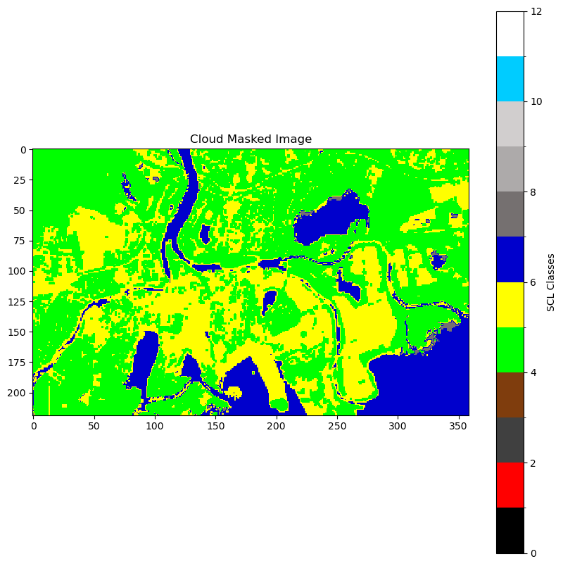
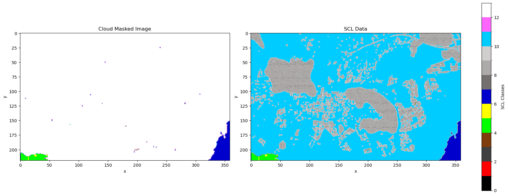
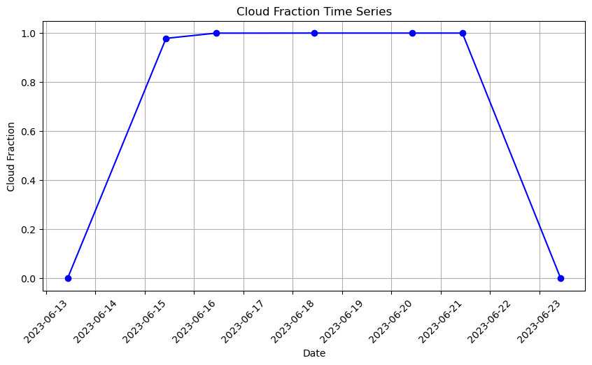
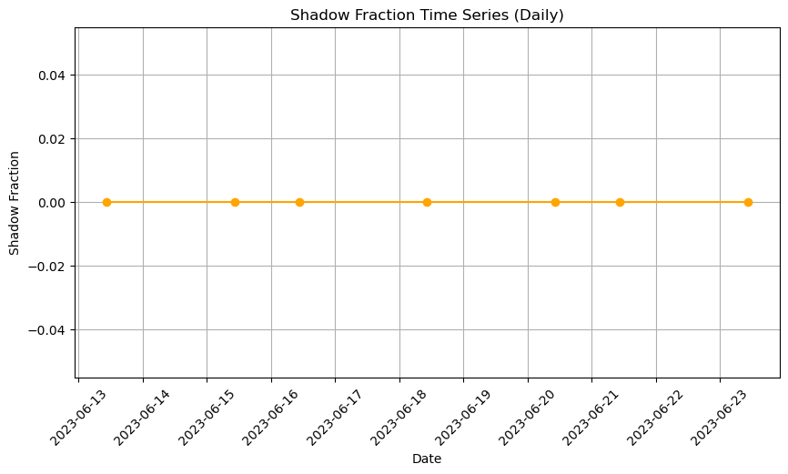

[Documentation home](../../README.md) · [Download Python script](gathering_examples_workshop.py)

Run from this directory with `python gathering_examples_workshop.py`. Read the guide first: the script runs all steps in order and may submit remote jobs. Figures and maps are saved under `outputs/gathering_examples_workshop/`.

> Historical workshop material. Examples may require additional services, credentials or repairs; they are preserved for reference.

> Saved outputs below come from the original teaching material; they are illustrations, not a fresh run against the current service.

# Workshop Preparations
2024-10-21 daniel.flemstrom@ri.se , nuria.agues.paszkowsky@ri.se


# Send a geometry and get back:

1. <span style="color:red">a time series with averages **(over a geometry?)**</span>,
2. <span style="color:green">an image for viewing **(TCI (RGB image))**</span>,
3. <span style="color:green">all band data, **(Gets a bit tricky, must read one cube per resolution)**</span>,
4. <span style="color:green">NDVI values **(use the NDVI process from the tutorial)**</span>,
5. <span style="color:green">cloud-masked image, **(SCL masked)**</span>,
6. <span style="color:green">shadow %, **( SCL, which flag)**</span>,
7. <span style="color:green">cloud %, **(SCL same flag as cloud mask)**</span>

## 1. A Time Series With Averages

### Step 5

```python
import openeo
from config import user,passwd,eo_service_url
import io
import rasterio.plot
import numpy as np
from demo_regions import s2
from matplotlib import pyplot as plt
plt.rcParams['figure.figsize'] = [20, 10]
```

### Step 6

```python

connection = openeo.connect(eo_service_url) 
display(
connection.authenticate_basic(username=user, password=passwd)
)
```

```text
<Connection to 'https://openeo.digitalearth.se/' with BasicBearerAuth>
```

### Step 7

```python
nmd_cube = conn.load_collection(
    "NMD_Produktivitet_v1_1",
    bands=["produktivitet"],  # Correctly specify the band
    spatial_extent=s2.polygons.d,
    temporal_extent=[],
)

# Mask everything that isn't "produktiv skogsmark"
nmd_mask = ~(nmd_cube == 1)
nmd_mask = nmd_mask.reduce_dimension(dimension="t", reducer="first") # We need to reduce time dimension to be able to use this as a mask (non ideal workaround)
display(
nmd_mask
)
```

[View saved example output](assets/gathering_examples_workshop/7-0.html)

### Step 8

```python
# Load S2MSI2A data
cube = conn.load_collection(
    s2.s2_msi_l2a,
    bands=["b11", "scl"],
    spatial_extent=s2.polygons.d,
    temporal_extent=["2020-03-01", "2020-08-01"],
    #max_cloud_cover=50, TODO this should work, need to fix
)

# we want to mask all other values, so NOT (2 OR 4 OR 5 OR 6)
scl =  cube.band("scl")
scl_mask = ~ ((scl == 2) | (scl == 4) | (scl == 5)  | (scl == 6))
display(
scl_mask
)
```

[View saved example output](assets/gathering_examples_workshop/8-0.html)

### Step 9

```python
# Get the b11 band, apply the masks, and calculate the median over the polygon
from openeo.processes import merge_cubes
b11 = cube.band("b11")
b11 = b11.mask(scl_mask)
#b11 = b11.mask(nmd_mask)
median_agg = b11.aggregate_spatial(geometries = s2.polygons.d, reducer = "median")
display(
median_agg
)
```

[View saved example output](assets/gathering_examples_workshop/9-0.html)

### Step 11

```python
# Unpack the response
medians = np.array(res["data"][0])
#times = np.array(res["t"])
```

### Step 12

```python
# Unpack the response
medians = np.array(res["data_vars"]["values"]["data"][0])
times = np.array(res["coordinates"]["t"])
```

### Step 13

```python
# Create None filter
valid_idxs = np.where(medians != None)[0]
```

### Step 14

```python
number_of_usable_pixels = pixel_count["data"][0]
max_number_of_usable_pixels = np.max(number_of_usable_pixels)
valid_idxs2 = np.where(np.array(number_of_usable_pixels) > max_number_of_usable_pixels * .98)[0]
```

### Step 15

```python
# Merge None and cloud filters
valid_idx_intersection = set(valid_idxs).intersection(valid_idxs2)
valid_idx_intersection = list(valid_idx_intersection)
valid_idx_intersection.sort()


# Apply filter
medians = medians[valid_idx_intersection]
times = times[valid_idx_intersection]
times = [datetime.fromtimestamp(timestamp/1e9) for timestamp in times]


display(
print(f"Number of valid observations: {len(valid_idx_intersection)}")
)
```

### Step 16

```python
# Plot values
plt.rcParams['figure.figsize'] = [12, 8]
plt.plot(times, medians)
plt.ylabel("median b11")
plt.xlabel("time")
plt.tight_layout()
display(
plt.savefig("median_b11.png", dpi=100, pad_inches=0)
)
```

## 2. RGB from guide 040_VIZ_010-RGB


--> [RGB Images](../../tutorials/040_VIZ_010-RGB.md)

## 3. All bands

<br> --> [Working with resolutions](./Resampling-Bands.md)

## 4. NDVI from guide 050_PROC_010-Processes-intro

--> [NDVI](../../tutorials/050_PROC_010-Processes-intro.md)

## 5. SCL masking clouds


### Step 25

```python
import openeo
from config import user,passwd,eo_service_url
import numpy as np
from demo_regions import s2
import matplotlib.pyplot as plt
from matplotlib.colors import ListedColormap, BoundaryNorm
from demo_helpers import load_netcdf_as_xarray
import pandas as pd
```

### Step 26

```python
# Connect to OpenEO
conn = openeo.connect(eo_service_url)

display(
conn.authenticate_basic(username=user, password=passwd)
)
```

```text
<Connection to 'https://openeo.digitalearth.se/' with BasicBearerAuth>
```

### Step 27

```python
# 1. Load the data
datacube = conn.load_collection(
    collection_id = "s2_msi_l2a",
    bands=["scl"], 
    spatial_extent=s2.bbox.karlstad_mini_land,
    temporal_extent=["2023-06-12", "2023-06-25"]
)
# Execute the process to retrieve the scl image data for future plotting
scldata = datacube.execute()

# 2. Mask what you want to remove from the image
scl =  datacube.band("scl")
cloud_mask =  ((scl == 8) | (scl == 9) | (scl == 10))
cloudmask_datacube = datacube.mask(cloud_mask) # 8, 9, and 10 represent clouds
```

When you apply `datacube.mask(cloud_mask)`, the cloud pixels (where cloud_mask is True) in the original data cube are replaced with `None` (or another value if you specify replacement). Non-cloud pixels remain unchanged.

### Step 29

```python
# 3. Execute the process to retrieve the cloud-masked image data
cloud_masked_image = cloudmask_datacube.execute()
```

Now we need to extract the pixel data for plotting. The clouds have been masked and therefore have a `None` value. We will replace them for a value of `12`to create a new class of masked pixels in SCL.

### Step 31

```python
# 4. Extract the pixel data and plot
# timestamp in time series: (t) - change if you want to see a different day
t = 0
# Replace None values with 12 before converting to NumPy array
image_data_raw = cloud_masked_image['data'][0][t]   # First band's data
image_data = np.array(image_data_raw, dtype=float)  # Convert to float for NaN handling
image_data = np.nan_to_num(image_data, nan=12)  # Replace NaN with 0# 5. Define a colormap for the scl values
# Create a custom colormap for the 12 classes (0 to 11)
cmap_scl = ListedColormap(
    [
        '#000000',  # 0: No data (black)
        '#FF0000',  # 1: Saturated or defective (red)
        '#404040',  # 2: Dark area pixels (dark grey)
        '#7F3D0D',  # 3: Cloud shadows (brown)
        '#00FF00',  # 4: Vegetation (green)
        '#FFFF00',  # 5: Not vegetated (yellow)
        '#0000CC',  # 6: Water (blue)
        '#757070',  # 7: Unclassified (grey)
        '#ADAAAA',  # 8: Cloud medium probability (light grey)
        '#D1CECE',  # 9: Cloud high probability (white)
        '#00CCFF',  # 10: Thin cirrus (cyan)
        '#FF66FF',  # 11: Snow or ice (pink)
        '#FFFFFF'   # 12: Masked pixels (white)
    ]
)


norm_scl = BoundaryNorm(range(0, 13), cmap_scl.N)

# 6. Plot the cloud-masked image with the custom colormap and norm
plt.figure(figsize=(10, 10))
plt.imshow(image_data, cmap=cmap_scl, norm=norm_scl)  # Set vmin and vmax to map 0-11 range
plt.title('Cloud Masked Image')
plt.colorbar(label="SCL Classes")
display(
plt.show()
)
```



Now we compare the values of SCL and our masked data to double check that the mask worked properly.

### Step 33

```python
# t is the timestamp we wish to plot. Change to see other days.
t = 1
# 4. Extract the pixel data from the cloud-masked image
image_data_raw = cloud_masked_image['data'][0][t]   # First band's data
image_data = np.array(image_data_raw, dtype=float)  # Convert to float for NaN handling
image_data = np.nan_to_num(image_data, nan=12)  # Replace NaN with 0

# Extract the pixel data from the scldata
scldata_raw = scldata['data'][0][t]  # First band's data for scldata
scldata_image = np.array(scldata_raw, dtype=float)  # Convert to float for NaN handling
scldata_image = np.nan_to_num(scldata_image, nan=0)  # Replace NaN with 0

# 5. Define a colormap for the SCL values
cmap_scl = ListedColormap(
    [
        '#000000',  # 0: No data (black)
        '#FF0000',  # 1: Saturated or defective (red)
        '#404040',  # 2: Dark area pixels (dark grey)
        '#7F3D0D',  # 3: Cloud shadows (brown)
        '#00FF00',  # 4: Vegetation (green)
        '#FFFF00',  # 5: Not vegetated (yellow)
        '#0000CC',  # 6: Water (blue)
        '#757070',  # 7: Unclassified (grey)
        '#ADAAAA',  # 8: Cloud medium probability (light grey)
        '#D1CECE',  # 9: Cloud high probability (white)
        '#00CCFF',  # 10: Thin cirrus (cyan)
        '#FF66FF',  # 11: Snow or ice (pink)
        '#FFFFFF'   # 12: Masked pixels (white)
    ]
)

norm_scl = BoundaryNorm(range(0, 14), cmap_scl.N)

# 6. Plot both images side by side with the custom colormap and norm
fig, axes = plt.subplots(1, 2, figsize=(20, 10))  # Create subplots (1 row, 2 columns)

# Plot the cloud-masked image
im1 = axes[0].imshow(image_data, cmap=cmap_scl, norm=norm_scl)
axes[0].set_title('Cloud Masked Image')
axes[0].set_xlabel('x')
axes[0].set_ylabel('y')

# Plot the SCL data image
im2 = axes[1].imshow(scldata_image, cmap=cmap_scl, norm=norm_scl)
axes[1].set_title('SCL Data')
axes[1].set_xlabel('x')
axes[1].set_ylabel('y')
cbar = fig.colorbar(plt.cm.ScalarMappable(cmap=cmap_scl, norm=norm_scl), ax=axes, orientation='vertical', fraction=0.02, pad=0.06)
cbar.set_label("SCL Classes")
fig.subplots_adjust(wspace=0.1, right=0.85)  # Add horizontal space between the plots

display(
plt.show()
)
```



## 7. Percentage of cloud

Get the timestamps from the original datacube to plot the time series and use the dates as labels in the axis. 

### Step 36

```python
downloaded_dc = datacube.download(format="netcdf")
```

The function load_netcdf_as_xarray reads the downloaded datacube and opens it as xarray so we can access the timestamps. 

### Step 38

```python
xarraydc = load_netcdf_as_xarray(downloaded_dc)
timestamps = np.array(xarraydc.t.values)
```

### Step 39

```python

# 1. Reduce the spatial dimension by calculating the fraction of cloudy pixels per time step.
cloud_fraction_timeseries = cloud_mask.reduce_dimension(
    dimension="x",  # Reducing along the x (longitude) axis
    reducer="mean"
).reduce_dimension(
    dimension="y",  # Then reducing along the y (latitude) axis
    reducer="mean"
)

# 2. Execute the process to get the time series result
time_series = cloud_fraction_timeseries.execute()

# 3. Extract cloud fraction values directly
cloud_fractions = time_series['data']  # Assuming the first band contains cloud fractions


timestamps = np.array(xarraydc.t.values)

# 4. Plot the data
plt.figure(figsize=(10, 5))
plt.plot(timestamps, cloud_fractions, marker='o', linestyle='-', color='blue')
plt.xlabel('Date')
plt.ylabel('Cloud Fraction')
plt.title('Cloud Fraction Time Series')
plt.xticks(rotation=45)
plt.grid(True)
display(
plt.show()
)
```



### Step 40

```python
display(
print(time_series)
)
```

```text
{'data': [0.0, 0.9785044708156854, 0.9997964920313912, 1.0, 1.0, 1.0, 0.0], 'dims': ['t'], 'attrs': {'crs': 'EPSG:3006', 'grid_mapping': 'spatial_ref', 'nodata': None, 'collection': 's2_msi_l2a', 'reduced_dimensions_min_values': {'bands': 'scl', 'x': 412510.0, 'y': 6581370.0}}}
```

## 6. Percentage of cloud shadow

We use `scl` from the previous sections to create a shadow mask. The same way we plotted the cloud time series above we can plot it for cloud shadows here.

### Step 43

```python
# 1. Create the shadow mask from the datacube
scl = datacube.band("scl")
shadow_mask = (scl == 3)  # Shadow mask

# 2. Apply the mask and reduce the spatial dimensions to calculate the fraction of shadow pixels per time step.
shadow_fraction_timeseries = shadow_mask.reduce_dimension(
    dimension="x",  # Reducing along the x (longitude) axis
    reducer="mean"
).reduce_dimension(
    dimension="y",  # Then reducing along the y (latitude) axis
    reducer="mean"
)

# 3. Execute the process to get the time series result
time_series2 = shadow_fraction_timeseries.execute()

# 4. Extract shadow fraction values directly
shadow_fractions = time_series2['data']  # Assuming the first band contains shadow fractions


# Get timestamps from the original datacube
timestamps = np.array(xarraydc.t.values)
# 5. Plot the data
plt.figure(figsize=(10, 5))
plt.plot(timestamps, shadow_fractions, marker='o', linestyle='-', color='orange')
plt.xlabel('Date')
plt.ylabel('Shadow Fraction')
plt.title('Shadow Fraction Time Series (Daily)')
plt.xticks(rotation=45)
plt.grid(True)
display(
plt.show()
)
```



### Step 44

```python
display(
time_series2
)
```

```text
{'data': [0.0, 0.0, 0.0, 0.0, 0.0, 0.0, 0.0],
 'dims': ['t'],
 'attrs': {'crs': 'EPSG:3006',
  'grid_mapping': 'spatial_ref',
  'nodata': None,
  'collection': 's2_msi_l2a',
  'reduced_dimensions_min_values': {'bands': 'scl',
   'x': 412510.0,
   'y': 6581370.0}}}
```

# Antal pixlar med vegetation (Daniel)

# Bild med moln, bild utan moln
# Tänkt att använda filter_quality, filter fine_quality (Daniel makes a figure)

# data från andra myndigheter
(ta deras SKS Cloud index grejorna som vi pillrat med för qindex)

- Interpolera direkt i bilderna, applicera ”curnals” (beräkningsrutor)
kernels????, menas indexrutorna ??? (Skrivit till Viktoria)


# Applicera något känt som tex är gjort på höjdmodellen, på något annat
- läsa in höjdmodell (kan vi ju inte göra, den måste göras produkt, stac_item.json och indexeras)


