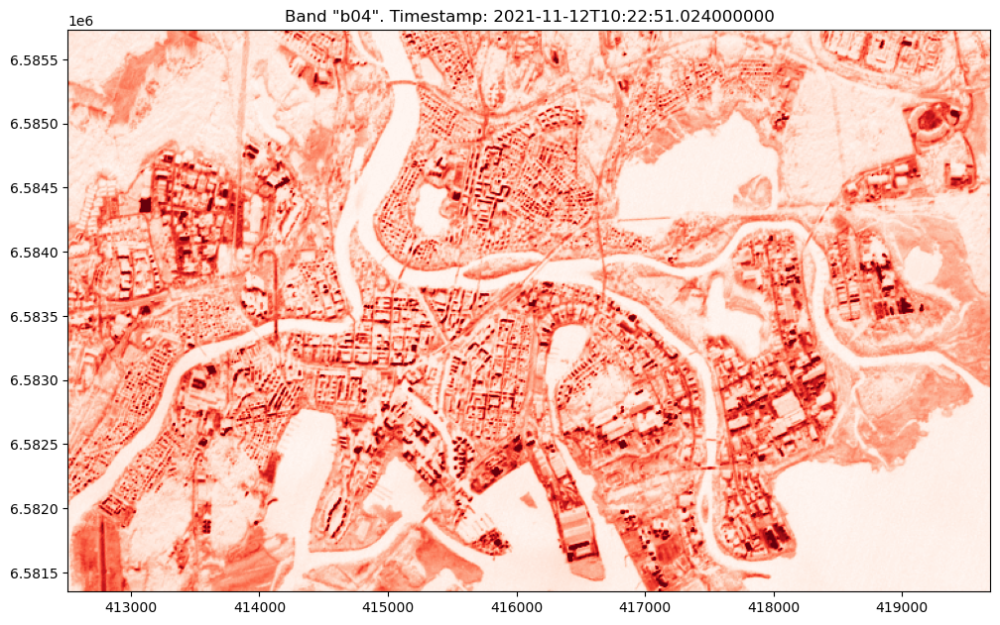
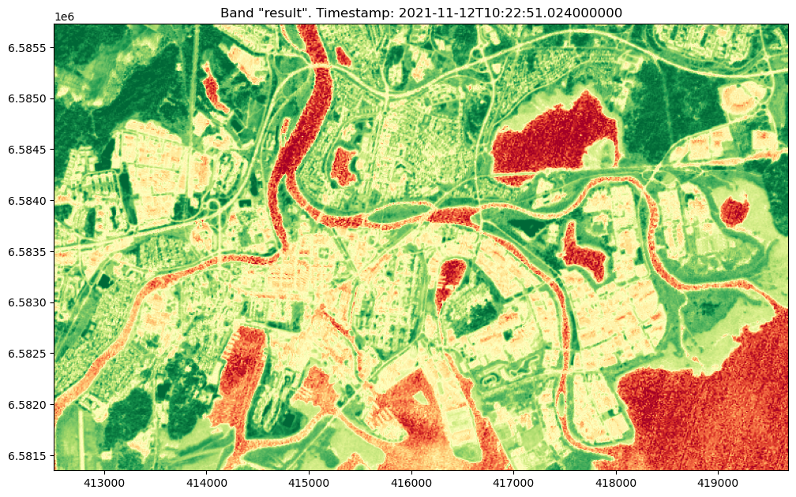

[Documentation home](../../README.md) · [Download Python script](Introduction.py)

Run from this directory with `python Introduction.py`. Read the guide first: the script runs all steps in order and may submit remote jobs. Figures and maps are saved under `outputs/Introduction/`.

> Historical workshop material. Examples may require additional services, credentials or repairs; they are preserved for reference.

> Saved outputs below come from the original teaching material; they are illustrations, not a fresh run against the current service.

## Introduction to DES OpenEO backend

The [OpenEO API](https://api.openeo.org/) is a standardized interface designed to simplify and harmonize the use of cloud-based Earth observation (EO) data processing services. It enables users to access and process EO data from various providers using a consistent API, making it easier to integrate and automate workflows.

Digital Earth Sweden (DES) has implemented the OpenEO backend as their API solution. DES initiative aims at making satellite data more accessible and usable for various applications.

The [DES OpenEO API](https://openeo.digitalearth.se) is a platform designed to facilitate access to Earth observation data of Sweden and processing capabilities.

### Step 2

```python
# Import some commonly used python packages
import openeo
from matplotlib import pyplot as plt
plt.rcParams['figure.figsize'] = [20, 10]

# Import some convenience modules made for this tutorial
from config import user,passwd,eo_service_url # This module contains some guide specifics
from demo_helpers import show_result # We have written some helper functions here
from demo_regions import s2, s3 # We have defined a few regions of interest to de-clutter the code
```

### Step 3

```python
# Connect to DES OpenEO backend
connection = openeo.connect(eo_service_url)

# connection.authenticate_basic(username=user, password=passwd)

# Connect with RISE authorized credentials
display(
connection.authenticate_oidc() 
)
```

[View saved example output](assets/Introduction/3-0.html)

[View saved example output](assets/Introduction/3-1.html)

```text
Authenticated using device code flow.
```

```text
<Connection to 'https://openeo.digitalearth.se/' with OidcBearerAuth>
```

# Collection

A “collection” in the context of the OpenEO API refers to a dataset or a group of datasets available for analysis and processing. These collections typically include various types of Earth observation data, such as satellite imagery, which come with detailed metadata describing their content and structure. Users can access and query these collections to perform different types of geospatial analyses.

### Step 5

```python
# To list all collection ids provided by the back-end
display(
connection.list_collection_ids()
)
```

```text
['NMD_2018_Basskikt_v1_1',
 'NMD_2018_Produktivitet_v1_1',
 's2_msi_l1c',
 's2_msi_l2a']
```

### Step 6

```python
# To get the complete metadata of a particular collection
display(
connection.describe_collection('s2_msi_l2a')
)
```

[View saved example output](assets/Introduction/6-0.html)

### Step 7

```python
# To list the basic metadata of all collections
display(
connection.list_collections()
)
```

[View saved example output](assets/Introduction/7-0.html)

## Datacube
When working with satellite data in OpenEO, we often use datacubes, which provide a structured way to handle complex, multi-dimensional EO data. Open DataCube provides a way of catalouging earth observation data through a PostgreSQL database. The Datacube itself is a multi-dimensional array of values representing Earth observation data. 

### From Collections to Datacubes:

In OpenEO, we begin by loading **collections** (datasets containing satellite imagery and other geospatial data) into a datacube. A collection is essentially a large repository of data, and when we specify a spatial extent, time range, and spectral bands, we extract a subset of this collection to create a datacube. This datacube is a more manageable and targeted representation of the data, ready for analysis.

### Step 9

```python
datacube=connection.load_collection(collection_id=s2.s2_msi_l2a,
                         spatial_extent=s2.bbox.karlstad_mini_land,
                         temporal_extent=s2.timespans.one_image,
                        bands=['b04'],
                        )
display(
datacube
)
```

[View saved example output](assets/Introduction/9-0.html)

### Step 10

```python
# Download the data as Gtiff
s2_image_data2 = datacube.download(format="gtiff")
```

### Step 11

```python
# Use our tutorial helper function to view the data!
display(
show_result(s2_image_data2, colormap="Reds")
)
```



```text
array([[[[238., 254., 312., ..., 465., 410., 438.],
         [273., 330., 332., ..., 493., 367., 333.],
         [321., 383., 313., ..., 298., 230., 279.],
         ...,
         [214., 228., 245., ..., 233., 158., 217.],
         [277., 290., 269., ..., 238., 193., 195.],
         [244., 247., 262., ..., 187., 180., 184.]]]])
```

## OpenEO Processes
We can utilize the DES OpenEO backend to do some heavy lifting in EO analysis. In EO analysis, processing large datasets on your own laptop can be extremely time-consuming and resource-intensive. This is where openEO provides a significant advantage. OpenEO allows you to construct and execute complex calculations, known as processes, on powerful backend servers rather than on your local machine. This approach frees up your resources and ensures that heavy computations are handled efficiently.

### Step 13

```python
# Explore list of processes

display(
connection.list_processes()
)
```

[View saved example output](assets/Introduction/13-0.html)

## Using Built-in Processes: NDVI

The `NDVI` process computes the ratio between the near-infrared (NIR) and red portions of the electromagnetic spectrum reflected by vegetation. This ratio highlights the presence and condition of live green vegetation, making it widely used in agriculture, forestry, and environmental monitoring.

### Step 15

```python
# Loading the data
cube=connection.load_collection(s2.s2_msi_l2a,
                         spatial_extent=s2.bbox.karlstad_mini_land,
                         temporal_extent=s2.timespans.one_image,
                         bands=['b04','b08'])
# Building and Executing the NDVI Process
res =cube.ndvi(nir="b08",red="b04").download(format="gtiff")
# Visulizing the result
_ = show_result(res,is_ndvi=True)

```


